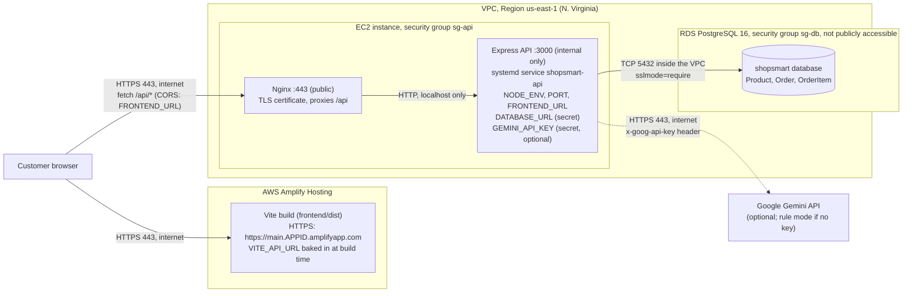

# ShopSmart AWS Deployment Plan

Status: **plan only.** What we are submitting now is a tested local release. We have not created anything in AWS yet; we will do that in the deployment assignment. Before we create any resource, the account owner will check our plan type, credits and service eligibility in Billing and Cost Management, and we will check each setting below against the current AWS documentation.

## 1. Our architecture: Amplify + EC2 + private RDS



| Connection | Crosses the internet? | Port | Configuration involved |
| --- | --- | --- | --- |
| Browser → Amplify | Yes, HTTPS | 443 | `VITE_API_URL` (public); SPA rewrite |
| Browser → Nginx on EC2 | Yes, HTTPS | 443 (80 only redirects to 443) | TLS certificate; the API checks `Origin` against `FRONTEND_URL` |
| Nginx → Express | No, same machine | 3000 on `127.0.0.1` | Not open in any security group |
| Express → RDS | No, private VPC traffic | 5432 | `DATABASE_URL` (secret, API only); `sg-db` allows only `sg-api` |
| Express → Gemini | Yes, HTTPS | 443 outbound | `GEMINI_API_KEY` (secret, API only) |

The browser never talks to PostgreSQL or Gemini directly. Everything goes through our Express API.

## 2. Our decisions

| Decision | What we chose | Why | What we are giving up |
| --- | --- | --- | --- |
| Layout | Amplify + EC2 + RDS | Each service has one job, the same frontend / API / database split we tested locally. With RDS our orders are safe even if we have to replace the EC2 instance, and backups are handled for us | More connections to set up, and three services using credits instead of one |
| Backup layout | One EC2 host (Nginx serves `frontend/dist` and proxies `/api`; PostgreSQL on the same instance) | Fewer services and one origin, so no CORS setup and only one certificate | One point of failure; we would have to back up the database ourselves, and deleting the volume deletes the data |
| Region | `us-east-1` (N. Virginia) | It is usually the cheapest Region for EC2 and RDS, so our credits last longer | It is far from us in the Philippines, so each request takes roughly 200 to 300 ms longer. That is fine for a short classroom demo. We will create everything in this one Region so we do not miss anything during cleanup |
| API HTTPS | Nginx with a certificate in front of Express | Amplify serves the site over HTTPS, and browsers block calls from an HTTPS page to an `http://` API (mixed content) | We need a hostname for the certificate (section 4) |
| AI provider | Rule mode (no key) | A paid provider is not required. Rule answers come straight from the catalog and the page already labels them `Answered from catalog data` | The demo will not show AI-written wording |
| Data | Fictional products and customers only | We do not have the access control or privacy safeguards needed for real people | Nothing |

If we cannot get an eligible account, enough credits or a safe HTTPS setup, the guide allows us to present our tested local release with this plan instead.

## 3. Frontend on AWS Amplify Hosting

- We will connect our GitHub repository and the `main` branch.
- Our project is an npm workspace with one lockfile at the root, so Amplify has to build from the root:

  ```yaml
  version: 1
  frontend:
    phases:
      preBuild:
        commands:
          - npm ci
      build:
        commands:
          - npm run build
    artifacts:
      baseDirectory: frontend/dist
      files:
        - '**/*'
    cache:
      paths:
        - node_modules/**/*
  ```

- In Amplify's environment variables we will set `VITE_API_URL=https://<api-hostname>/api`. Vite puts this value into the JavaScript at build time, so it is public, and if the API address changes we have to rebuild.
- We will add a rewrite rule so that refreshing `/cart`, `/checkout`, `/assistant` or `/products/2` does not give a 404. Source: `</^[^.]+$|\.(?!(css|gif|ico|jpg|js|png|txt|svg|woff|woff2|ttf|map|json|webp)$)([^.]+$)/>`, target: `/index.html`, type: `200 (Rewrite)`.
- A green Amplify build only tells us the files were built. We will check that products actually load separately (section 9).

## 4. Express API on EC2

**Instance:** Amazon Linux 2023, the smallest instance type our account plan allows (for example `t3.micro` or `t4g.micro`), an 8 to 20 GB gp3 volume, in a public subnet of the default VPC.

**Runtime and code:** we will install Node.js 22 and Git, clone our repository at a known commit, and run from the project root:

```bash
npm ci --include=dev
npm run db:generate
npm run db:deploy
```

We need `--include=dev` because `prisma`, which `db:generate` and `db:deploy` use, is a dev dependency.

**Server settings:** we will keep these in `/etc/shopsmart/api.env`, owned by root with mode `600`, and never in the repository:

```text
NODE_ENV=production
PORT=3000
FRONTEND_URL=https://main.<appid>.amplifyapp.com
DATABASE_URL=<RDS connection string, see section 5>
AI_PROVIDER=gemini
GEMINI_API_KEY=
AI_TIMEOUT_MS=8000
```

If we would rather not keep `DATABASE_URL` and `GEMINI_API_KEY` in a file, AWS Systems Manager Parameter Store (SecureString) is our alternative.

**Keeping Express running:** an EC2 instance does not restart our server by itself, so we will run Express as a systemd service. It starts at boot and restarts after a crash:

```ini
[Unit]
Description=ShopSmart API
After=network-online.target

[Service]
WorkingDirectory=/opt/shopsmart/backend
EnvironmentFile=/etc/shopsmart/api.env
ExecStart=/usr/bin/node src/server.js
Restart=on-failure
User=shopsmart

[Install]
WantedBy=multi-user.target
```

We will read the logs with `journalctl -u shopsmart-api`. Our API already logs a request id with each error and never logs the provider key.

**HTTPS:** Nginx will listen on 443, handle TLS and forward `/api/` to `http://127.0.0.1:3000`. The certificate needs a hostname pointing to the instance's Elastic IP. Our options:

1. A class or team domain with a Let's Encrypt certificate (certbot). This is our first choice.
2. If we have no domain: an IP-based hostname (for example `<elastic-ip>.sslip.io`) with certbot, or an Amazon CloudFront distribution in front of the instance, which gives us an HTTPS `*.cloudfront.net` address.

**Security group `sg-api`:**

| Direction | Port | Source | Why |
| --- | --- | --- | --- |
| Inbound | 443 | `0.0.0.0/0` | Public HTTPS API |
| Inbound | 80 | `0.0.0.0/0` | Only to redirect to HTTPS and for certificate validation |
| Inbound | 22 | Only our administrator's own IP (`/32`), or closed if we use Session Manager | Administration |
| Inbound | 3000 | **Not opened** | Express is only reached through Nginx |
| Outbound | All | Default | Package installs, Gemini, RDS |

**Code changes we must make before going online** (in the deployment assignment, not in this release):

- Add `app.set('trust proxy', 1)` to `backend/src/app.js`, because Nginx sits one proxy hop in front of Express. Without it, every visitor appears to come from Nginx, so all of them share the assistant's limit of 20 questions per minute.
- Build sign-in and order ownership (section 8).

## 5. PostgreSQL on Amazon RDS

- PostgreSQL 16, the smallest instance class our account plan allows (for example `db.t4g.micro`), Single-AZ, 20 GB gp3 storage.
- **Public access: No.** Same VPC as our EC2 instance.
- Security group `sg-db`: inbound 5432 **only from `sg-api`**. Nothing else, and never `0.0.0.0/0`.
- Automated backups for 1 to 7 days, plus a manual snapshot before every migration.
- Its own database user with a new strong password, not the class `shopsmart_dev` password. We will keep the password only in `/etc/shopsmart/api.env` (or Parameter Store) and a password manager.
- `DATABASE_URL=postgresql://<user>:<password>@<rds-endpoint>:5432/shopsmart?schema=public&sslmode=require`
- This value will never go in the repository, a screenshot, a chat or any `VITE_` variable.

## 6. Migrations without losing data

1. We take a manual RDS snapshot before every migration.
2. On the EC2 instance we run `npm run db:deploy` (`prisma migrate deploy`). It only applies the committed migrations in `backend/prisma/migrations` that have not run yet, does not need a shadow database, and never resets data.
3. We never run `npm run db:migrate` (`prisma migrate dev`) against RDS. It is for local development and can ask to reset the database if it finds drift.
4. Only on first use, while the RDS database is still empty, we run `npm run db:seed` once to load the six fictional products. After the first order exists we never run it again, because the seed script deletes all orders and products.
5. New schema changes (for example adding an order owner for sign-in) are made locally with `npm run db:migrate`, committed, and only reach RDS through `db:deploy`.
6. As evidence of our migration history, we will include the output of `npx prisma migrate status` from the EC2 instance.

We tested this locally on 2026-11-13: `npm run db:deploy` on a database with orders reported `No pending migrations to apply.` and the order count stayed at 3.

## 7. Secrets

| Variable | Where we keep it | Secret? |
| --- | --- | --- |
| `VITE_API_URL` | Amplify environment variables (build time) | No, public |
| `NODE_ENV`, `PORT`, `FRONTEND_URL`, `AI_PROVIDER`, `GEMINI_MODEL`, `AI_TIMEOUT_MS` | `/etc/shopsmart/api.env` on EC2 | No |
| `DATABASE_URL` | `/etc/shopsmart/api.env` (mode 600) or Parameter Store SecureString | **Yes** |
| `GEMINI_API_KEY` | Same place as `DATABASE_URL`; empty for rule mode | **Yes** |
| RDS master password, AWS credentials | Password manager / IAM only | **Yes** |

- `FRONTEND_URL` will be exactly our Amplify origin: scheme and host, no path, no trailing slash. CORS only allows that one origin.
- After every Amplify build we will search the deployed JavaScript for `GEMINI`, `DATABASE_URL` and `postgresql://`. Nothing should match.

## 8. Accounts and access

- **AWS access (IAM):** our account owner protects the root user with MFA and does not share the root sign-in. Each of us gets our own IAM identity with only the permissions we need (Amplify, EC2 and RDS in our Region). IAM only controls who can manage AWS resources. It does not protect customer orders.
- **ShopSmart sign-in:** our current release has no sign-in. The deployment guide requires a fictional test customer to sign in, and the API to refuse a guest or another customer who tries to read an order. This is the Week 4 roadmap feature. We have to build it and test it locally (guest, owner and another customer, by direct API request) before the online demo.
- **Who can open the demo:** only our team and our instructor. We will share the URLs only through the class submission, and we will use only fictional customer data and simulated checkout.

## 9. How we will check the hosted version

For each check we will write the expected result first, use a fresh browser with the real URLs, and record the URL, status code, commit and a redacted screenshot.

| Check | What we expect to see |
| --- | --- |
| Frontend and direct route | The Amplify URL loads; refreshing `/cart` and `/assistant` still shows the app |
| API connection | The Network tab shows requests going to `https://<api-hostname>/api`; `/api/health` returns `{"status":"ok"}`; no CORS or mixed-content errors |
| Catalog and cart | Six products; searching `keyboard` works; changing quantities keeps the totals correct |
| Account and order | A guest is refused private data; the owner can read their own order; another customer is refused by direct API request (once sign-in exists) |
| Simulated checkout | A valid fictional order is saved; an invalid email and too many units are refused |
| Assistant | The keyboard question cites product 2 at its current price; the gaming chair question gives an honest no-match; answers are labeled as catalog or AI |
| Restart and logs | After `sudo systemctl restart shopsmart-api` and an instance reboot, products and earlier orders are still there; we can trace errors in `journalctl` by request id, and no secrets appear |
| Secrets and credits | No secret in the repository, the Amplify JavaScript or our screenshots; credits stay within our plan |

`/api/health` only proves Express is answering. Products loading is what proves the database connection works.

## 10. Costs and resource register

Each of these uses credits (or is billed on a Paid plan) for as long as it exists, even when nobody visits:

| Service | Resource | Region | Owner | Purpose | Created | Planned removal |
| --- | --- | --- | --- | --- | --- | --- |
| Amplify Hosting | ShopSmart app | us-east-1 | | Frontend | | |
| EC2 | Instance + EBS volume | us-east-1 | | Express API | | |
| EC2 | Elastic IP (public IPv4 is charged per hour) | us-east-1 | | Stable API address | | |
| RDS | PostgreSQL instance + storage | us-east-1 | | Database | | |
| RDS | Manual snapshots | us-east-1 | | Pre-migration backups | | |

Before creating anything, we will take a redacted screenshot of our account plan (Free or Paid), credit balance and expiry date.

**When the demo ends we will remove everything:** delete the Amplify app; terminate the EC2 instance and make sure its EBS volume is deleted; release the Elastic IP; delete the RDS instance (deciding first whether to keep a final snapshot) and any leftover manual snapshots; delete `sg-api` and `sg-db`; then check Billing and every Region for anything we missed.

## 11. If something goes wrong (rollback)

- Frontend: redeploy the last good Amplify build.
- API: check out the previous commit on EC2, run `npm ci --include=dev && npm run db:generate`, then `sudo systemctl restart shopsmart-api`.
- Database: our migrations only add things. If we ever need to undo one, we restore the snapshot taken before it instead of editing the migration history.
