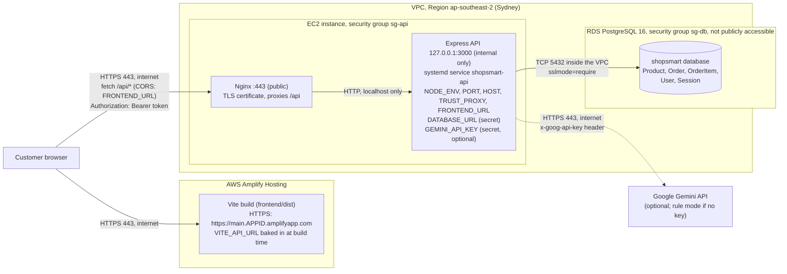

# ShopSmart AWS Deployment Plan

Status: **ready to deploy, not deployed yet.** My code now has everything this plan needs (sign-in, order ownership, `TRUST_PROXY`, `HOST` and a database readiness check), tested locally on 2026-11-19. I have not created anything in AWS yet. Before I create any resource, the account owner will check my plan type, credits and service eligibility in Billing and Cost Management, and I will check each setting below against the current AWS documentation.

## 1. My architecture: Amplify + EC2 + private RDS



| Connection | Crosses the internet? | Port | Configuration involved |
| --- | --- | --- | --- |
| Browser → Amplify | Yes, HTTPS | 443 | `VITE_API_URL` (public); SPA rewrite |
| Browser → Nginx on EC2 | Yes, HTTPS | 443 (80 only redirects to 443) | TLS certificate; the API checks `Origin` against `FRONTEND_URL` |
| Nginx → Express | No, same machine | 3000 on `127.0.0.1` | Not open in any security group |
| Express → RDS | No, private VPC traffic | 5432 | `DATABASE_URL` (secret, API only); `sg-db` allows only `sg-api` |
| Express → Gemini | Yes, HTTPS | 443 outbound | `GEMINI_API_KEY` (secret, API only) |

The browser never talks to PostgreSQL or Gemini directly. Everything goes through my Express API.

## 2. My decisions

| Decision | What I chose | Why | What I am giving up |
| --- | --- | --- | --- |
| Layout | Amplify + EC2 + RDS | Each service has one job, the same frontend / API / database split I tested locally. With RDS my orders are safe even if I have to replace the EC2 instance, and backups are handled for me | More connections to set up, and three services using credits instead of one |
| Backup layout | One EC2 host (Nginx serves `frontend/dist` and proxies `/api`; PostgreSQL on the same instance) | Fewer services and one origin, so no CORS setup and only one certificate | One point of failure; I would have to back up the database myself, and deleting the volume deletes the data |
| Region | `ap-southeast-2` (Sydney) | My account is on the AWS Free plan, and its project is assigned to Sydney. Other Regions need a paid plan, which would remove the Free plan's protection that stops service instead of charging my card when credits run out. Sydney is also much closer to the Philippines than N. Virginia, my first choice, so pages respond faster | Sydney costs a little more per hour than N. Virginia, which my credits still cover for a short demo. I will create everything in this one Region so I do not miss anything during cleanup |
| API HTTPS | Nginx with a certificate in front of Express | Amplify serves the site over HTTPS, and browsers block calls from an HTTPS page to an `http://` API (mixed content) | I need a hostname for the certificate (section 4) |
| AI provider | Gemini (`gemini-3.5-flash-lite`) if I have an approved key, which I tested live on 2026-11-16; otherwise rule mode | A paid provider is not required. Every AI answer is checked against the catalog, and the page labels each answer `AI-drafted, verified against the catalog` or `Answered from catalog data` | Without a key, the demo will not show AI-written wording |
| Sign-in | My own email and password accounts. Passwords are hashed with scrypt; each sign-in creates a random session token that the API stores only as a SHA-256 hash and that expires after 24 hours. The browser keeps the token in `sessionStorage` and sends it as `Authorization: Bearer <token>` | My frontend (`amplifyapp.com`) and API are different sites. Browsers such as Safari and Firefox block cross-site cookies by default, so a cookie session could fail; a header works in every browser and cannot be sent by another site (no CSRF) | If a script ever ran inside my page (XSS), it could read the token. React escapes everything it displays, I have no third-party scripts, and tokens expire after 24 hours or at sign-out |
| Data | Fictional products and customers only | My sign-in protects orders, but I have no password reset, email verification or privacy policy, which real customers would need | Nothing |

If I cannot get an eligible account, enough credits or a safe HTTPS setup, the guide allows me to present my tested local release with this plan instead.

## 3. Frontend on AWS Amplify Hosting

- I will connect my GitHub repository and the `main` branch.
- My project is an npm workspace with one lockfile at the root, so Amplify has to build from the root:

  ```yaml
  version: 1
  frontend:
    phases:
      preBuild:
        commands:
          - npm ci
      build:
        commands:
          - npm run build
    artifacts:
      baseDirectory: frontend/dist
      files:
        - '**/*'
    cache:
      paths:
        - node_modules/**/*
  ```

- In Amplify's environment variables I will set `VITE_API_URL=https://<api-hostname>/api`. Vite puts this value into the JavaScript at build time, so it is public, and if the API address changes I have to rebuild.
- I will add a rewrite rule so that refreshing `/cart`, `/checkout`, `/assistant` or `/products/2` does not give a 404. Source: `</^[^.]+$|\.(?!(css|gif|ico|jpg|js|png|txt|svg|woff|woff2|ttf|map|json|webp)$)([^.]+$)/>`, target: `/index.html`, type: `200 (Rewrite)`.
- A green Amplify build only tells me the files were built. I will check that products actually load separately (section 9).

## 4. Express API on EC2

**Instance:** Amazon Linux 2023, the smallest instance type my account plan allows (for example `t3.micro` or `t4g.micro`), an 8 to 20 GB gp3 volume, in a public subnet of the default VPC.

**Runtime and code:** I will install Node.js 22 and Git, clone my repository at a known commit, and run from the project root:

```bash
npm ci --include=dev
npm run db:generate
npm run db:deploy
```

I need `--include=dev` because `prisma`, which `db:generate` and `db:deploy` use, is a dev dependency.

**Server settings:** I will keep these in `/etc/shopsmart/api.env`, owned by root with mode `600`, and never in the repository:

```text
NODE_ENV=production
PORT=3000
HOST=127.0.0.1
TRUST_PROXY=1
FRONTEND_URL=https://main.<appid>.amplifyapp.com
DATABASE_URL=<RDS connection string, see section 5>
AI_PROVIDER=gemini
GEMINI_API_KEY=
AI_TIMEOUT_MS=8000
```

If I would rather not keep `DATABASE_URL` and `GEMINI_API_KEY` in a file, AWS Systems Manager Parameter Store (SecureString) is my alternative.

**Keeping Express running:** an EC2 instance does not restart my server by itself, so I will run Express as a systemd service. It starts at boot and restarts after a crash:

```ini
[Unit]
Description=ShopSmart API
After=network-online.target

[Service]
WorkingDirectory=/opt/shopsmart/backend
EnvironmentFile=/etc/shopsmart/api.env
ExecStart=/usr/bin/node src/server.js
Restart=on-failure
User=shopsmart

[Install]
WantedBy=multi-user.target
```

I will read the logs with `journalctl -u shopsmart-api`. My API already logs a request id with each error and never logs the provider key.

**HTTPS:** Nginx will listen on 443, handle TLS and forward `/api/` to `http://127.0.0.1:3000`. The certificate needs a hostname pointing to the instance's Elastic IP. My options:

1. A class domain or my own domain with a Let's Encrypt certificate (certbot). This is my first choice.
2. If I have no domain: an IP-based hostname (for example `<elastic-ip>.sslip.io`) with certbot, or an Amazon CloudFront distribution in front of the instance, which gives me an HTTPS `*.cloudfront.net` address.

**Security group `sg-api`:**

| Direction | Port | Source | Why |
| --- | --- | --- | --- |
| Inbound | 443 | `0.0.0.0/0` | Public HTTPS API |
| Inbound | 80 | `0.0.0.0/0` | Only to redirect to HTTPS and for certificate validation |
| Inbound | 22 | Only my own IP (`/32`), or closed if I use Session Manager | Administration |
| Inbound | 3000 | **Not opened** | Express is only reached through Nginx |
| Outbound | All | Default | Package installs, Gemini, RDS |

**Settings that protect the API behind Nginx** (already built and tested locally on 2026-11-19):

- `HOST=127.0.0.1` makes Express listen only on the instance itself. Even if port 3000 were opened by mistake, it could not be reached from outside. Locally I checked that the API answered on `127.0.0.1` and not on the machine's network address.
- `TRUST_PROXY=1` tells Express that Nginx sits one proxy hop in front of it, so it reads each visitor's real address from `X-Forwarded-For`. Without it, every visitor looks like Nginx and they all share the assistant's limit of 20 questions per minute. Locally I checked that, without the setting, a second visitor was blocked as soon as the first one hit the limit; with `TRUST_PROXY=1`, the second visitor was not blocked.
- Sign-in attempts (`/api/auth/register` and `/api/auth/login`) are limited to 20 per visitor every 15 minutes, which also depends on `TRUST_PROXY`.

## 5. PostgreSQL on Amazon RDS

- PostgreSQL 16, the smallest instance class my account plan allows (for example `db.t4g.micro`), Single-AZ, 20 GB gp3 storage.
- **Public access: No.** Same VPC as my EC2 instance.
- Security group `sg-db`: inbound 5432 **only from `sg-api`**. Nothing else, and never `0.0.0.0/0`.
- Automated backups for 1 to 7 days, plus a manual snapshot before every migration.
- Its own database user with a new strong password, not the class `shopsmart_dev` password. I will keep the password only in `/etc/shopsmart/api.env` (or Parameter Store) and a password manager.
- `DATABASE_URL=postgresql://<user>:<password>@<rds-endpoint>:5432/shopsmart?schema=public&sslmode=require`
- This value will never go in the repository, a screenshot, a chat or any `VITE_` variable.

## 6. Migrations without losing data

1. I take a manual RDS snapshot before every migration.
2. On the EC2 instance I run `npm run db:deploy` (`prisma migrate deploy`). It only applies the committed migrations in `backend/prisma/migrations` that have not run yet, does not need a shadow database, and never resets data.
3. I never run `npm run db:migrate` (`prisma migrate dev`) against RDS. It is for local development and can ask to reset the database if it finds drift.
4. Only on first use, while the RDS database is still empty, I run `npm run db:seed` once to load the six fictional products. After the first order exists I never run it again, because the seed script deletes all orders and products.
5. New schema changes are made locally with `npm run db:migrate`, committed, and only reach RDS through `db:deploy`. I already have two committed migrations: `20260924093739_initial_schema` and `20261119112252_add_users_and_sessions`. The second one only adds the `User` and `Session` tables and an optional `Order.userId` column, so existing orders are kept (with no owner).
6. As evidence of my migration history, I will include the output of `npx prisma migrate status` from the EC2 instance.

I tested this locally. On 2026-11-13, `npm run db:deploy` on a database with orders reported `No pending migrations to apply.` and the order count stayed at 3. On 2026-11-19, applying `add_users_and_sessions` to my local database kept all 6 products and all 5 existing orders.

## 7. Secrets

| Variable | Where I keep it | Secret? |
| --- | --- | --- |
| `VITE_API_URL` | Amplify environment variables (build time) | No, public |
| `NODE_ENV`, `PORT`, `HOST`, `TRUST_PROXY`, `FRONTEND_URL`, `AI_PROVIDER`, `GEMINI_MODEL`, `AI_TIMEOUT_MS` | `/etc/shopsmart/api.env` on EC2 | No |
| Customer passwords and session tokens | Only as scrypt and SHA-256 hashes in the `User` and `Session` tables | **Yes**: never logged, never shown in screenshots |
| `DATABASE_URL` | `/etc/shopsmart/api.env` (mode 600) or Parameter Store SecureString | **Yes** |
| `GEMINI_API_KEY` | Same place as `DATABASE_URL`; empty for rule mode | **Yes** |
| RDS master password, AWS credentials | Password manager / IAM only | **Yes** |

- `FRONTEND_URL` will be exactly my Amplify origin: scheme and host, no path, no trailing slash. CORS only allows that one origin.
- After every Amplify build I will search the deployed JavaScript for `GEMINI`, `DATABASE_URL` and `postgresql://`. Nothing should match.

## 8. Accounts and access

- **AWS access:** I sign in with my AWS Builder ID, protected with an authenticator app (MFA) and a recovery email, and I never share the sign-in. On the Free plan, AWS gives other people access through the team page, not IAM users; IAM users are only for programmatic access, and I do not need any. AWS sign-in only controls who can manage AWS resources. It does not protect customer orders.
- **ShopSmart sign-in:** customers create an account and sign in (`/api/auth/register`, `/api/auth/login`). Checkout requires sign-in, and every new order is saved with its owner. `GET /api/orders` and `GET /api/orders/:id` only return the signed-in customer's orders. A guest gets 401, and another customer gets 404 `ORDER_NOT_FOUND`, the same answer as an order that does not exist, so the API does not reveal which order numbers belong to other people. I tested all three cases by direct API request on 2026-11-19 (Test Record TC-20).
- **Who can open the demo:** only me and my instructor. I will share the URLs only through the class submission, and I will use only fictional customer data and simulated checkout.

## 9. How I will check the hosted version

For each check I will write the expected result first, use a fresh browser with the real URLs, and record the URL, status code, commit and a redacted screenshot.

| Check | What I expect to see |
| --- | --- |
| Frontend and direct route | The Amplify URL loads; refreshing `/cart` and `/assistant` still shows the app |
| API connection | The Network tab shows requests going to `https://<api-hostname>/api`; `/api/health/ready` returns `{"status":"ok","database":"ok"}`; no CORS or mixed-content errors |
| Catalog and cart | Six products; searching `keyboard` works; changing quantities keeps the totals correct |
| Account and order | A fictional customer can create an account, sign in and place an order. By direct API request: a guest gets 401 on `GET /api/orders`; the owner gets 200 on their own order; a second customer gets 404 on the first customer's order |
| Simulated checkout | A valid fictional order is saved; an invalid email and too many units are refused |
| Assistant | The keyboard question cites product 2 at its current price; the gaming chair question gives an honest no-match; answers are labeled as catalog or AI |
| Restart and logs | After `sudo systemctl restart shopsmart-api` and an instance reboot, products and earlier orders are still there; I can trace errors in `journalctl` by request id, and no secrets appear |
| Secrets and credits | No secret in the repository, the Amplify JavaScript or my screenshots; credits stay within my plan |

`/api/health` only proves Express is answering. `/api/health/ready` runs a real database query, so it also proves Express can reach RDS; it returns HTTP 503 when the database cannot be reached. I will use `/api/health/ready` as the health check after deploying and after restarts.

## 10. Costs and resource register

Each of these uses credits (or is billed on a Paid plan) for as long as it exists, even when nobody visits:

| Service | Resource | Region | Owner | Purpose | Created | Planned removal |
| --- | --- | --- | --- | --- | --- | --- |
| Amplify Hosting | ShopSmart app | ap-southeast-2 | | Frontend | | |
| EC2 | Instance + EBS volume | ap-southeast-2 | | Express API | | |
| EC2 | Elastic IP (public IPv4 is charged per hour) | ap-southeast-2 | | Stable API address | | |
| RDS | PostgreSQL instance + storage | ap-southeast-2 | | Database | | |
| RDS | Manual snapshots | ap-southeast-2 | | Pre-migration backups | | |

Before creating anything, I recorded my account plan, credit balance and expiry date, set up MFA and created a zero-spend budget. The redacted screenshots are in `DEPLOYMENT_RECORD.md` section 1.

**When the demo ends I will remove everything:** delete the Amplify app; terminate the EC2 instance and make sure its EBS volume is deleted; release the Elastic IP; delete the RDS instance (deciding first whether to keep a final snapshot) and any leftover manual snapshots; delete `sg-api` and `sg-db`; then check Billing and every Region for anything I missed.

## 11. If something goes wrong (rollback)

- Frontend: redeploy the last good Amplify build.
- API: check out the previous commit on EC2, run `npm ci --include=dev && npm run db:generate`, then `sudo systemctl restart shopsmart-api`.
- Database: my migrations only add things. If I ever need to undo one, I restore the snapshot taken before it instead of editing the migration history.
