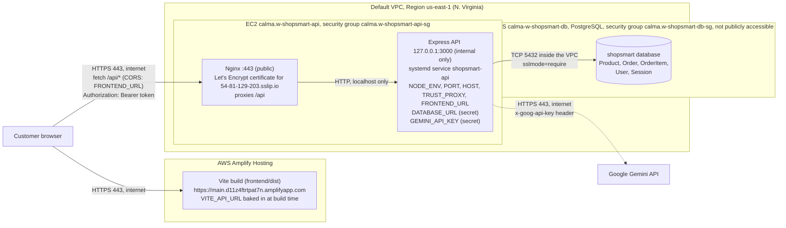

# ShopSmart AWS Deployment Plan

Status: **deployed and tested on 2026-11-20.** ShopSmart runs on AWS in US East (N. Virginia), `us-east-1`, using Amplify + EC2 + private RDS. `DEPLOYMENT_RECORD.md` shows what I did step by step, with evidence. This plan explains the design and the reasons behind it.

| Item | Value |
| --- | --- |
| Frontend | https://main.d11z4ftrtpat7n.amplifyapp.com |
| API | https://54-81-129-203.sslip.io/api |
| Region | `us-east-1` (US East, N. Virginia) |
| AWS plan | Free plan, US$49.40 in credits remaining on 2026-11-20, free access ends 2027-03-21 |
| Code version | commit `4483dc9` on `main` |

## 1. My architecture: Amplify + EC2 + private RDS



| Connection | Crosses the internet? | Port | Configuration involved |
| --- | --- | --- | --- |
| Browser → Amplify | Yes, HTTPS | 443 | `VITE_API_URL` (public); SPA rewrite |
| Browser → Nginx on EC2 | Yes, HTTPS | 443 (80 only redirects to 443) | Let's Encrypt certificate; the API checks `Origin` against `FRONTEND_URL` |
| Nginx → Express | No, same machine | 3000 on `127.0.0.1` | Not open in any security group |
| Express → RDS | No, private VPC traffic | 5432 | `DATABASE_URL` (secret, API only); `calma.w-shopsmart-db-sg` allows only `calma.w-shopsmart-api-sg` |
| Express → Gemini | Yes, HTTPS | 443 outbound | `GEMINI_API_KEY` (secret, API only) |

The browser never talks to PostgreSQL or Gemini directly. Everything goes through my Express API.

## 2. My decisions

| Decision | What I chose | Why | What I am giving up |
| --- | --- | --- | --- |
| Layout | Amplify + EC2 + RDS | Each service has one job, the same frontend / API / database split I tested locally. With RDS my orders are safe even if I have to replace the EC2 instance, and backups are handled for me | More connections to set up, and three services using credits instead of one |
| Backup layout | One EC2 host (Nginx serves `frontend/dist` and proxies `/api`; PostgreSQL on the same instance) | Fewer services and one origin, so no CORS setup and only one certificate | One point of failure; I would have to back up the database myself, and deleting the volume deletes the data |
| Account and Region | A Free plan account whose project is in `us-east-1` (N. Virginia) | My first Free plan account was locked to Sydney (`DEPLOYMENT_RECORD.md` section 1). I deployed in this account instead, so N. Virginia, the Region in my first plan, became available without upgrading to a Paid plan. On the Free plan, AWS stops service instead of charging when credits run out | The credits are shared with anything else running in this account, so I keep the unrelated `askrizza-prod` instance stopped and I watch the balance. The account had US$49.40 left on 2026-11-20 |
| API HTTPS | Nginx with a Let's Encrypt certificate in front of Express, on the hostname `54-81-129-203.sslip.io` | Amplify serves the site over HTTPS, and browsers block calls from an HTTPS page to an `http://` API (mixed content). I have no domain, and `sslip.io` resolves `54-81-129-203.sslip.io` to my Elastic IP, so certbot can issue a certificate for it | The hostname depends on the Elastic IP; if I release the IP, I need a new certificate and a new Amplify build |
| Database user | The RDS master user `shopsmart_admin` | A short classroom demo with fictional data; one fewer setup step | The API has more database rights than it needs. For a longer release I would create a separate application user |
| AI provider | Gemini (`gemini-3.5-flash-lite`) with the key stored only on the server | A paid provider is not required, but the key I have works. Every AI answer is checked against the catalog, and the page labels each answer `AI-drafted, verified against the catalog` or `Answered from catalog data` | Nothing; without a key the assistant still answers from catalog data |
| Sign-in | My own email and password accounts. Passwords are hashed with scrypt; each sign-in creates a random session token that the API stores only as a SHA-256 hash and that expires after 24 hours. The browser keeps the token in `sessionStorage` and sends it as `Authorization: Bearer <token>` | My frontend (`amplifyapp.com`) and API (`sslip.io`) are different sites. Browsers such as Safari and Firefox block cross-site cookies by default, so a cookie session could fail; a header works in every browser and cannot be sent by another site (no CSRF) | If a script ever ran inside my page (XSS), it could read the token. React escapes everything it displays, I have no third-party scripts, and tokens expire after 24 hours or at sign-out |
| Data | Fictional products and customers only | My sign-in protects orders, but I have no password reset, email verification or privacy policy, which real customers would need | Nothing |

## 3. Frontend on AWS Amplify Hosting

- App `eCommerce_ShopSmart` (App ID `d11z4ftrtpat7n`), connected to my GitHub repository and the `main` branch. "My app is a monorepo" is not ticked, because the build runs from the repository root.
- My project is an npm workspace with one lockfile at the root, so Amplify builds from the root with `amplify.yml`, which is committed in the repository:

  ```yaml
  version: 1
  frontend:
    phases:
      preBuild:
        commands:
          - nvm install 22 && nvm use 22
          - npm ci
      build:
        commands:
          - test -n "$VITE_API_URL" || (echo "VITE_API_URL is not set" && exit 1)
          - npm run build
    artifacts:
      baseDirectory: frontend/dist
      files:
        - '**/*'
    cache:
      paths:
        - node_modules/**/*
  ```

- Amplify environment variable: `VITE_API_URL=https://54-81-129-203.sslip.io/api`. Vite puts this value into the JavaScript at build time, so it is public, and if the API address changes I have to rebuild. The build stops if the variable is missing.
- Rewrite rule so that refreshing `/cart`, `/checkout`, `/assistant` or `/products/2` does not give a 404. Source: `</^[^.]+$|\.(?!(css|gif|ico|jpg|js|png|txt|svg|woff|woff2|ttf|map|json|webp)$)([^.]+$)/>`, target: `/index.html`, type: `200 (Rewrite)`.
- A green Amplify build only tells me the files were built. I checked separately that products load (section 9).

## 4. Express API on EC2

**Instance:** `calma.w-shopsmart-api`, Amazon Linux 2023, `t3.micro`, in `us-east-1c`, in the default VPC, with the Elastic IP `54.81.129.203` (`calma.w-shopsmart-ip`).

**Setup script:** I set up the instance with `deploy/ec2-setup.sh`, which is committed in the repository. I run it as `ec2-user` with:

```bash
API_HOST=54-81-129-203.sslip.io bash ec2-setup.sh
```

The script can be run again safely. It:

1. Adds 1 GB of swap, because a `t3.micro` has 1 GB of RAM and `npm ci` for both workspaces can run out of memory.
2. Installs Git, Nginx and Node.js 22 from the Amazon Linux repositories.
3. Creates the system user `shopsmart` and clones the repository into `/opt/shopsmart` at a known commit (`GIT_REF`, default `main`).
4. Creates `/etc/shopsmart/api.env` on the first run and stops, so that I enter `DATABASE_URL` myself. Secrets never go into the script or the repository.
5. Runs `npm ci --include=dev`, `npm run db:generate` and `npm run db:deploy`. I need `--include=dev` because `prisma`, which `db:generate` and `db:deploy` use, is a dev dependency.
6. Installs and starts the systemd service `shopsmart-api`, then checks `http://127.0.0.1:3000/api/health/ready`.
7. Configures Nginx and gets a Let's Encrypt certificate with certbot, which also sets up automatic renewal.

With `SEED=1`, the script also runs the seed script. I used it only once, on the empty database.

**Server settings:** in `/etc/shopsmart/api.env`, owned by root with mode `600`, never in the repository:

```text
NODE_ENV=production
PORT=3000
HOST=127.0.0.1
TRUST_PROXY=1
FRONTEND_URL=https://main.d11z4ftrtpat7n.amplifyapp.com
DATABASE_URL='<RDS connection string, see section 5>'
AI_PROVIDER=gemini
GEMINI_API_KEY=<secret>
GEMINI_MODEL=gemini-3.5-flash-lite
AI_TIMEOUT_MS=8000
```

`DATABASE_URL` is in single quotes because it contains `&`. systemd removes the quotes, and the shell does not treat `&` as a background command.

**Keeping Express running:** an EC2 instance does not restart my server by itself, so Express runs as a systemd service that starts at boot and restarts after a crash:

```ini
[Unit]
Description=ShopSmart API
After=network-online.target
Wants=network-online.target

[Service]
WorkingDirectory=/opt/shopsmart/backend
EnvironmentFile=/etc/shopsmart/api.env
ExecStart=/usr/bin/node src/server.js
Restart=on-failure
RestartSec=3
User=shopsmart

[Install]
WantedBy=multi-user.target
```

I read the logs with `journalctl -u shopsmart-api`. My API logs each request with its status code, logs a request id with each error, and never logs the provider key.

**HTTPS:** Nginx listens on 443 with the certificate for `54-81-129-203.sslip.io`, forwards `/api/` to `http://127.0.0.1:3000`, and returns 404 for every other path. Port 80 only redirects to HTTPS. The certificate expires on 2027-02-18 and renews automatically.

**Security group `calma.w-shopsmart-api-sg`:**

| Direction | Port | Source | Why |
| --- | --- | --- | --- |
| Inbound | 443 | `0.0.0.0/0` | Public HTTPS API |
| Inbound | 80 | `0.0.0.0/0` | Only to redirect to HTTPS and for certificate validation |
| Inbound | 22 | My own IP (`/32`) | Administration from my computer |
| Inbound | 22 | Prefix list `com.amazonaws.us-east-1.ec2-instance-connect` | Browser access through EC2 Instance Connect, which connects from AWS addresses, not from my IP |
| Inbound | 3000 | **Not opened** | Express is only reached through Nginx |
| Outbound | All | Default | Package installs, Gemini, RDS |

**Settings that protect the API behind Nginx** (built and tested locally on 2026-11-19, TC-23):

- `HOST=127.0.0.1` makes Express listen only on the instance itself. Even if port 3000 were opened by mistake, it could not be reached from outside. On EC2, the service log shows `ShopSmart API running at http://127.0.0.1:3000`.
- `TRUST_PROXY=1` tells Express that Nginx sits one proxy hop in front of it, so it reads each visitor's real address from `X-Forwarded-For`. Without it, every visitor looks like Nginx and they all share the assistant's limit of 20 questions per minute.
- Sign-in attempts (`/api/auth/register` and `/api/auth/login`) are limited to 20 per visitor every 15 minutes, which also depends on `TRUST_PROXY`.

## 5. PostgreSQL on Amazon RDS

- `calma-w-shopsmart-db`: PostgreSQL, `db.t4g.micro`, Single-AZ, in `us-east-1c`, in the same default VPC as my EC2 instance. Database name `shopsmart`, master user `shopsmart_admin`.
- **Publicly accessible: No.**
- Security group `calma.w-shopsmart-db-sg`: inbound 5432 **only from `calma.w-shopsmart-api-sg`**. Nothing else, and never `0.0.0.0/0`.
- Automated backups, plus a manual snapshot before every future migration.
- The master password is kept only in `/etc/shopsmart/api.env` and my password manager.
- `DATABASE_URL='postgresql://shopsmart_admin:<password>@calma-w-shopsmart-db.c032kwy2idby.us-east-1.rds.amazonaws.com:5432/shopsmart?schema=public&sslmode=require'`. Special characters in the password are URL-encoded (`@` → `%40`, `#` → `%23`, `/` → `%2F`, `:` → `%3A`).
- This value never goes in the repository, a screenshot, a chat or any `VITE_` variable.

## 6. Migrations without losing data

1. I take a manual RDS snapshot before every future migration.
2. On the EC2 instance, `npm run db:deploy` (`prisma migrate deploy`) only applies the committed migrations in `backend/prisma/migrations` that have not run yet. It does not need a shadow database and never resets data. `ec2-setup.sh` runs it on every deploy.
3. I never run `npm run db:migrate` (`prisma migrate dev`) against RDS. It is for local development and can ask to reset the database if it finds drift.
4. I ran the seed script once, on 2026-11-20, while the RDS database was still empty, to load the six fictional products. I will never run it again, because the seed script deletes all orders and products.
5. New schema changes are made locally with `npm run db:migrate`, committed, and only reach RDS through `db:deploy`. RDS has both committed migrations: `20260924093739_initial_schema` and `20261119112252_add_users_and_sessions`.

## 7. Secrets

| Variable | Where I keep it | Secret? |
| --- | --- | --- |
| `VITE_API_URL` | Amplify environment variables (build time) | No, public |
| `NODE_ENV`, `PORT`, `HOST`, `TRUST_PROXY`, `FRONTEND_URL`, `AI_PROVIDER`, `GEMINI_MODEL`, `AI_TIMEOUT_MS` | `/etc/shopsmart/api.env` on EC2 | No |
| Customer passwords and session tokens | Only as scrypt and SHA-256 hashes in the `User` and `Session` tables | **Yes**: never logged; tokens are blacked out in my screenshots |
| `DATABASE_URL` | `/etc/shopsmart/api.env` (root, mode 600) | **Yes** |
| `GEMINI_API_KEY` | `/etc/shopsmart/api.env` (root, mode 600) | **Yes** |
| RDS master password, AWS sign-in | Password manager only | **Yes** |

- `FRONTEND_URL` is exactly my Amplify origin: scheme and host, no path, no trailing slash. CORS only allows that one origin.
- My AWS account ID is blacked out in every screenshot.

## 8. Accounts and access

- **AWS access:** only I manage the ShopSmart resources, and I do not share the AWS sign-in. AWS sign-in only controls who can manage AWS resources. It does not protect customer orders.
- **ShopSmart sign-in:** customers create an account and sign in (`/api/auth/register`, `/api/auth/login`). Checkout requires sign-in, and every new order is saved with its owner. `GET /api/orders` and `GET /api/orders/:id` only return the signed-in customer's orders. A guest gets 401, and another customer gets 404 `ORDER_NOT_FOUND`, the same answer as an order that does not exist, so the API does not reveal which order numbers belong to other people. I tested this on the hosted API on 2026-11-20 (`DEPLOYMENT_RECORD.md` section 5).
- **Who can open the demo:** only me and my instructor. I share the URLs only through the class submission, and I use only fictional customer data and simulated checkout.

## 9. How I check the hosted version

For each check I wrote the expected result first, used the real URLs, and recorded the result with a redacted screenshot. The results are in `DEPLOYMENT_RECORD.md` section 5.

| Check | What I expect to see |
| --- | --- |
| Frontend and direct route | The Amplify URL loads; refreshing `/cart` still shows the app |
| API connection | Requests go to `https://54-81-129-203.sslip.io/api`; `/api/health/ready` returns `{"status":"ok","database":"ok"}`; no CORS or mixed-content errors |
| Catalog and cart | Six products; adding items keeps the totals correct |
| Account and order | A fictional customer can create an account, sign in, place an order and see it under My orders. By direct API request: a guest gets 401; the owner gets 200 on their own order; a second customer gets 404 on the first customer's order |
| Simulated checkout | A valid fictional order is saved; an invalid email and too many units are refused, in the browser and by direct API request |
| Assistant | The keyboard question cites product 2 at its current price; the gaming chair question gives an honest no-match; answers are labeled as catalog or AI |
| Restart and logs | After `sudo systemctl restart shopsmart-api` and an instance reboot, products and earlier orders are still there; requests show in `journalctl` with no secrets |
| Secrets and credits | No secret in the repository, the Amplify JavaScript or my screenshots; credits stay within my plan |

`/api/health` only proves Express is answering. `/api/health/ready` runs a real database query, so it also proves Express can reach RDS; it returns HTTP 503 when the database cannot be reached.

## 10. Costs and resource register

Each of these uses credits for as long as it exists, even when nobody visits:

| Service | Resource | Region | Purpose | Created | Planned removal |
| --- | --- | --- | --- | --- | --- |
| RDS | `calma-w-shopsmart-db` (PostgreSQL, `db.t4g.micro`) + storage and automated backups | us-east-1 | Database | 2026-11-20 | After grading |
| EC2 | `calma.w-shopsmart-api` (`t3.micro`) + EBS volume | us-east-1 | Nginx and Express API | 2026-11-20 | After grading |
| EC2 | Elastic IP `calma.w-shopsmart-ip` (54.81.129.203; public IPv4 is charged per hour) | us-east-1 | Stable API address | 2026-11-20 | After grading |
| EC2 | Security groups `calma.w-shopsmart-api-sg` and `calma.w-shopsmart-db-sg` | us-east-1 | Network access | 2026-11-20 | After grading |
| Amplify Hosting | `eCommerce_ShopSmart` (`d11z4ftrtpat7n`) | us-east-1 | Frontend | 2026-11-20 | After grading |

The other EC2 instance in this account, `askrizza-prod`, is not part of ShopSmart. It uses the same credits, so I keep it stopped while my demo runs.

**When the demo ends I will remove everything:** delete the Amplify app; terminate the EC2 instance and make sure its EBS volume is deleted; release the Elastic IP; delete the RDS instance (deciding first whether to keep a final snapshot) and any manual snapshots; delete `calma.w-shopsmart-api-sg` and `calma.w-shopsmart-db-sg`; then check Billing and every Region for anything I missed.

## 11. If something goes wrong (rollback)

- Frontend: redeploy the last good Amplify build.
- API: run `GIT_REF=<previous commit> API_HOST=54-81-129-203.sslip.io bash ec2-setup.sh`, which checks out that commit, reinstalls, regenerates Prisma and restarts `shopsmart-api`.
- Database: my migrations only add things. If I ever need to undo one, I restore the snapshot taken before it instead of editing the migration history.
